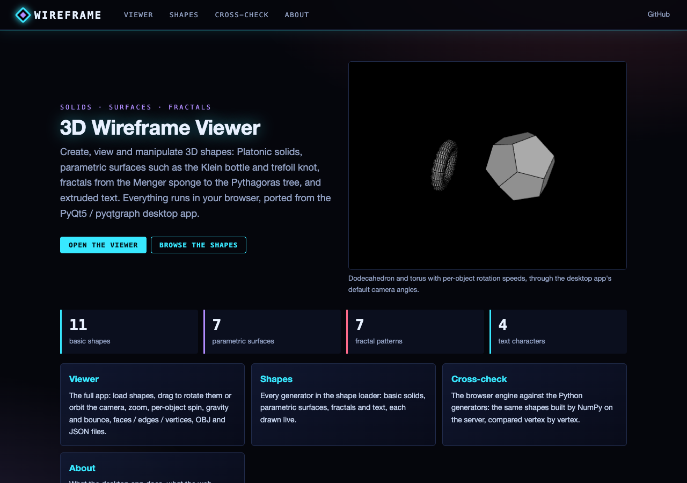
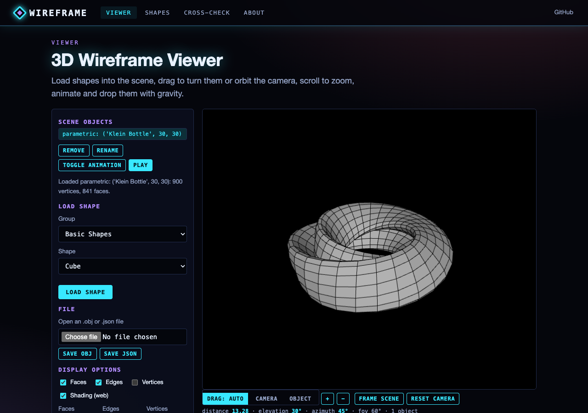
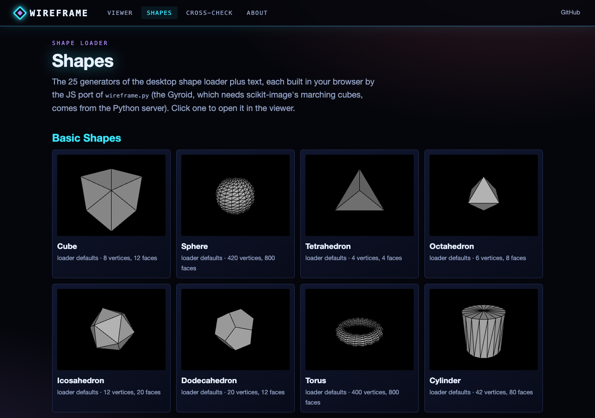
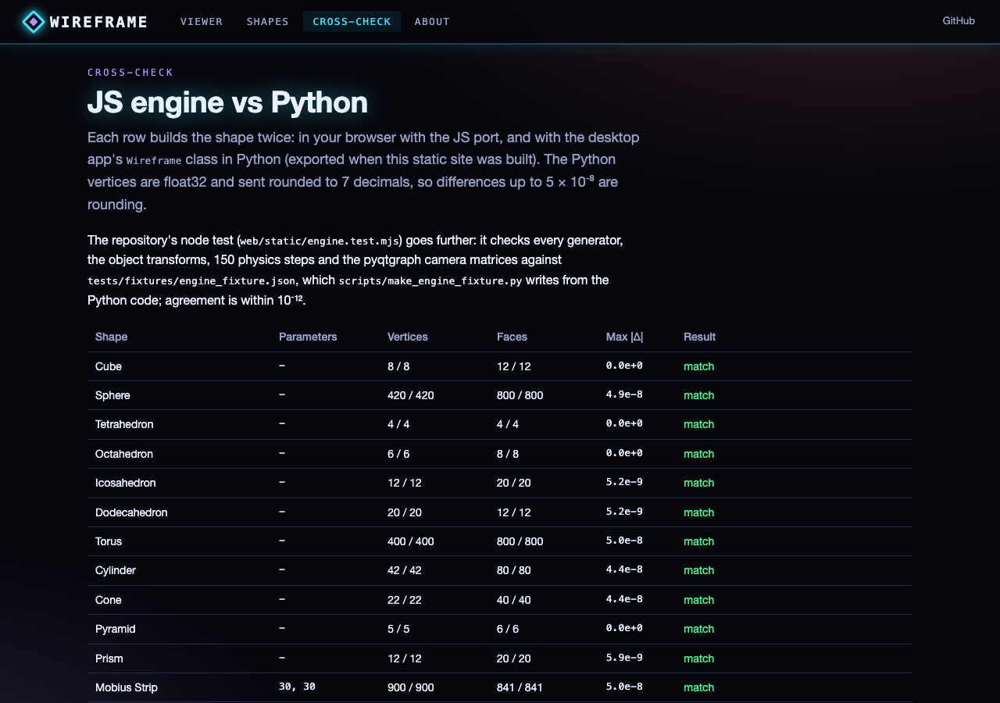

# 3D Wireframe Viewer and Physics Simulator

This project is a Python-based 3D visualization tool that allows users to create, view, and manipulate various 3D shapes. It aims to become a versatile platform for 3D data visualization, physics and animation.

**Web version:** the viewer also runs in the browser (shapes, camera, animation and physics ported to JavaScript): see [Web app](#web-app) below.

> Related: [wireframe_display](https://github.com/gddickinson/wireframe_display) is a separate, earlier Pygame project with its own matrix code and orthographic projection. The two share their purpose, a few solids (tetrahedron, octahedron, icosahedron, sphere, torus, sine surface) and the same letter-A geometry, but no code; each repository is self-contained.

## Features

- **3D Shape Generation**: 11 basic geometries (cube, sphere, Platonic solids, torus, cylinder, cone, pyramid, prism), 7 parametric surfaces (Mobius strip, Klein bottle, trefoil knot, helicoid, catenoid, sine surface, gyroid), 7 fractals (Sierpinski triangle and tetrahedron, Koch snowflake, Menger sponge, Apollonian gasket, Jerusalem cube, 3D Pythagoras tree) and text in A-Z, 0-9 and ! (glyphs in `letter_glyphs.json`, read by `letter_definitions.py` and the web viewer; written by `scripts/make_glyphs.py`).
- **Data Visualization** (planned): the shape loader has MRI and super-resolution buttons, but their loaders (`Wireframe.load_mri`, `Wireframe.load_super_resolution`) are not written yet, so they report an error.
- **Scene Management**: Add multiple objects to a scene; rename, delete, edit properties (mass, scale, rotation speed) from the list's right-click menu.
- **Real-time Transformations**: translation and scale sliders for the whole scene; drag an object to rotate it (Ctrl + drag to move it).
- **Display Customization**: a Display Options dialog (faces, edges, vertices, colours, sizes); at present only "Show Faces" changes the view.
- **Basic Physics Simulation** (in progress): `Scene.update_physics` (gravity and a bounce at y = 0) exists, but its call in the update loop is commented out, so Play does not run it yet. The web version runs it.
- **Animation**: per-object rotation at a set speed (right-click > Toggle Animation, speeds in Properties).
- **File Operations**: open and save single objects as OBJ or JSON.

## Prerequisites

- Python 3.7+
- PyQt5
- PyQtGraph
- NumPy
- SciPy and scikit-image (the Gyroid uses scikit-image's marching cubes)

## Installation

1. Clone this repository:
   ```
   git clone https://github.com/gddickinson/wireframeDisplay.git
   cd wireframeDisplay
   ```

2. Install the required packages:
   ```
   pip install -r requirements.txt
   ```

## Usage

Run the main script to start the application:

```
python wireframe_viewer.py
```

- Use the "Load Shape" button to add shapes to your scene.
- Manipulate shapes using the transformation controls.
- Toggle display options in the "Display Options" dialog.
- Right-click an object in the list for Rename, Delete, Properties and Toggle Animation; double-click it to centre the camera on it.
- The wheel zooms the camera.

## Web app

The same viewer runs in the browser: the shape generators, the object transform (scale and rotate about the centre, then
translate), the physics step and pyqtgraph's orbit camera are ported to JavaScript (`web/static/`) and tested against
numbers from the Python code. The static site published to GitHub Pages is the full viewer; the local app adds a Python
API (the loader catalogue, shapes built by `wireframe.py` for cross-checking, and the Gyroid at any resolution).

```
pip install -r requirements-web.txt
python run_web.py                          # http://127.0.0.1:8119
python -m pytest -q tests/                 # web, engine and desktop regression tests (offscreen Qt)
node web/static/engine.test.mjs            # JS engine vs tests/fixtures/engine_fixture.json
python scripts/build_static.py --out site  # static site, as published by .github/workflows/pages.yml
```

Pages: **Viewer** (load shapes, drag to rotate an object or orbit the camera, wheel / buttons to zoom, per-object spin,
Play for gravity and bounce, faces / edges / vertices with colours and sizes, OBJ / JSON open and save), **Shapes** (every
generator drawn live), **Cross-check** (JS vs Python, shape by shape) and **About**.

| Home | Viewer |
|---|---|
|  |  |
| **Shapes** | **Cross-check** |
|  |  |

## Future Goals

- Enhanced Physics Simulation: Implement more complex physics interactions and constraints.
- Advanced Animation Tools: Add keyframe animation and shape morphing capabilities.
- Particle Systems: Implement particle effects for simulations like fire, smoke, or fluid dynamics.
- Improved Data Import: Expand supported formats for 3D data import, including point clouds and volumetric data.
- Rendering Enhancements: Add support for textures, materials, and advanced lighting models.
- Performance Optimization: Implement level-of-detail rendering and optimize for large datasets.
- Collaborative Features: Add basic networking for shared viewing sessions.

## Contributing

Contributions to this project are welcome! Please feel free to submit a Pull Request.

## License

This project is licensed under the MIT License - see the [LICENSE](LICENSE) file for details.

## Acknowledgments

- Thanks to the PyQt and PyQtGraph teams for their excellent libraries.


